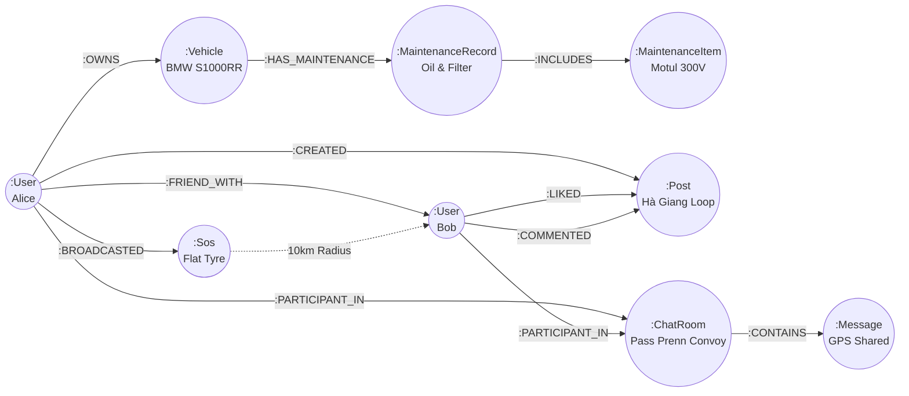

# ⚙️ WayMate Service (Backend Microservice)

[](https://openjdk.org/projects/jdk/21/)
[](https://spring.io/projects/spring-boot)
[](https://neo4j.com/)
[](https://spring.io/projects/spring-security)
[](https://spring.io/)
[](LICENSE)

> Core REST and WebSocket backend service for the **WayMate** platform. Built with Java 21, Spring Boot, and **Neo4j Graph Database** to power community friendships, vehicle telemetry, real-time messaging, and high-performance 10km radius emergency SOS dispatch.

---

## 🧭 Table of Contents

- [🏛️ Architectural Overview](#️-architectural-overview)
- [🌐 Graph Data Model (Neo4j)](#-graph-data-model-neo4j)
- [🚀 Key Modules & Capabilities](#-key-modules--capabilities)
- [📡 WebSocket Real-Time Chat Engine](#-websocket-real-time-chat-engine)
- [🚨 Emergency SOS Radius Dispatch Engine](#-emergency-sos-radius-dispatch-engine)
- [📂 Project Directory Structure](#-project-directory-structure)
- [📊 REST API Endpoints](#-rest-api-endpoints)
- [⚙️ Configuration & Environment Variables](#️-configuration--environment-variables)
- [🛠️ Build, Test & Run](#️-build-test--run)

---

## 🏛️ Architectural Overview

WayMate Service implements a clean, decoupled layered architecture:
```
Client Requests (HTTP / WebSocket)
               │
               ▼
┌──────────────────────────────────────────────┐
│  Security Layer (JWT Filter + CORS)          │
└──────────────────────┬───────────────────────┘
                       │
                       ▼
┌──────────────────────────────────────────────┐
│  Controller Layer (REST & WebSocket Handlers)│
└──────────────────────┬───────────────────────┘
                       │
                       ▼
┌──────────────────────────────────────────────┐
│  Service Layer (Business Logic & Algorithms) │
└──────────────────────┬───────────────────────┘
                       │
                       ▼
┌──────────────────────────────────────────────┐
│  Repository Layer (Spring Data Neo4j Cypher) │
└──────────────────────┬───────────────────────┘
                       │
                       ▼
┌──────────────────────────────────────────────┐
│  Neo4j Graph Database (Nodes & Relationships)│
└──────────────────────────────────────────────┘
```

---

## 🌐 Graph Data Model (Neo4j)

WayMate leverages Neo4j graph nodes and directional relationships to model real-world social and vehicular connections naturally:



### Core Nodes & Properties
- **`User`**: `id`, `email`, `name`, `password`, `avatar`, `bio`, `phoneNumber`, `latitude`, `longitude`, `travelStyle`, `roles`.
- **`Vehicle`**: `id`, `name`, `brand`, `plateNumber`, `currentOdoKm`, `year`, `capacity`.
- **`MaintenanceRecord`**: `id`, `name`, `serviceDate`, `totalCost`, `location`, `odoAtService`.
- **`ChatRoom`**: `id`, `name`, `isGroup`, `creatorId`, `lastMessagePreview`, `updatedAt`.
- **`Message`**: `id`, `roomId`, `senderId`, `senderName`, `senderAvatar`, `type` (`TEXT`, `IMAGE`, `LOCATION`, `TRIP`), `content`, `attachmentUrl`, `locationMeta`, `createdAt`.
- **`Sos`**: `id`, `name`, `location`, `latitude`, `longitude`, `userId`, `phoneNumber`, `bikeInfo`, `description`, `status` (`PENDING`, `HELPING`, `RESOLVED`), `createdAt`, `updatedAt`.
- **`Notification`**: `id`, `userId`, `title`, `content`, `type` (`SOS`, `POST_LIKE`, `POST_COMMENT`, `POST_SHARE`), `senderId`, `senderName`, `senderAvatar`, `referenceId`, `metadataJson`, `isRead`, `createdAt`.

---

## 🚀 Key Modules & Capabilities

### 1. 🔐 Security & Identity (`UserController`, `JwtTokenProvider`)
- **Stateless Authentication**: High-entropy JWT tokens with configurable expiration (default 24 hours).
- **Password Security**: Strong BCrypt hashing for all stored credentials.
- **Google OAuth2**: Token verification and automatic user profile synchronization.
- **Forgot Password Flow**: Secure 6-digit verification code delivered directly via **Jakarta Mail (SMTP)**.

### 2. 🏍️ Garage & Telemetry Engine (`VehicleController`, `MaintenanceController`)
- Complete CRUD operations for motorcycles and cars.
- Real-time Odometer (ODO) updates.
- Service history creation and calculation of upcoming maintenance due milestones.

### 3. 🚨 Emergency SOS & Radius Dispatch (`SosController`, `SosService`)
- Immediate storage of roadside breakdown incidents.
- Mathematical **Haversine formula** execution across active rider coordinates.
- Automatic creation and dispatch of high-priority emergency notifications to all riders within **10 km**.
- Endpoint to query detailed emergency info by ID (`GET /api/v1/sos/{id}`).
- Community status updates (`PUT /api/v1/sos/{id}/status` -> `HELPING` or `RESOLVED`).

### 4. 💬 Real-Time Messenger & Read Receipts (`ChatController`, `ChatService`)
- 1-on-1 direct rooms and multi-rider group chats.
- WebSocket message broadcast and database persistence.
- Real-time unread counter per room and across all user rooms (`GET /api/v1/chat/unread-count`).
- Read receipt synchronization (`POST /api/v1/chat/rooms/{roomId}/read`).

### 5. 🔔 Notification System (`NotificationController`, `NotificationService`)
- Real-time in-app notification center.
- Distinguishes between SOS emergencies, chat messages, and social reactions (likes, comments, shares).
- Instant mark-read and unread count queries.

---

## 📡 WebSocket Real-Time Chat Engine

- **Handshake Endpoint**: `ws://localhost:8781/ws/chat`
- **Application Destination Prefix**: `/app`
- **Broker Topic Prefix**: `/topic`

### Subscription Topics
| Topic | Description |
| :--- | :--- |
| `/topic/room.{roomId}` | Subscribes to all real-time incoming messages within a specific chat room. |
| `/topic/user.{userId}` | Personal channel for private alerts, typing status, and direct notifications. |
| `/topic/sos` | Broadcast channel for public emergency roadside alerts within community radius. |

---

## 🚨 Emergency SOS Radius Dispatch Engine

The SOS engine computes the great-circle distance between the emergency location and all registered riders using the **Haversine formula**:

$$\Delta\sigma = 2 \arcsin \left( \sqrt{\sin^2\left(\frac{\Delta\phi}{2}\right) + \cos(\phi_1)\cos(\phi_2)\sin^2\left(\frac{\Delta\lambda}{2}\right)} \right)$$

$$d = R \cdot \Delta\sigma$$

*(where $R = 6,371\text{ km}$, $\phi$ is latitude in radians, $\lambda$ is longitude in radians)*

Any active rider within $d \le 10.0\text{ km}$ receives an immediate notification with embedded GPS coordinates, bike details, and contact phone number.

---

## 📂 Project Directory Structure

```
waymate-service/
├── pom.xml                               # Maven project object model & dependencies
├── mvnw / mvnw.cmd                       # Maven wrapper executables
└── src/
    ├── main/
    │   ├── java/com/waymate/service/
    │   │   ├── WaymateServiceApplication.java # Spring Boot entrypoint
    │   │   ├── config/
    │   │   │   ├── CorsConfig.java            # Cross-Origin Resource Sharing rules
    │   │   │   ├── Neo4jConfig.java           # Neo4j client and transaction manager
    │   │   │   ├── SecurityConfig.java        # Spring Security filter chain & public paths
    │   │   │   └── WebSocketConfig.java       # STOMP broker registration & endpoint mappings
    │   │   ├── controller/
    │   │   │   ├── ChatController.java        # Chat rooms, messaging, unread counts
    │   │   │   ├── FriendController.java      # Social friendship graph operations
    │   │   │   ├── MaintenanceController.java # Vehicle maintenance history & logs
    │   │   │   ├── NotificationController.java# In-app notifications & read receipts
    │   │   │   ├── PostController.java        # Social feed, posts, likes, comments
    │   │   │   ├── SosController.java         # Emergency SOS broadcast & status
    │   │   │   ├── UserController.java        # Auth, signup, signin, forgot password
    │   │   │   └── VehicleController.java     # User garage and ODO management
    │   │   ├── model/                         # Neo4j @Node entities
    │   │   │   ├── ChatRoom.java
    │   │   │   ├── MaintenanceRecord.java
    │   │   │   ├── Message.java
    │   │   │   ├── Notification.java
    │   │   │   ├── Post.java
    │   │   │   ├── Sos.java
    │   │   │   ├── User.java
    │   │   │   └── Vehicle.java
    │   │   ├── payload/                       # Request & Response DTOs
    │   │   ├── repository/                    # Spring Data Neo4j Repositories
    │   │   └── service/                       # Business logic services
    │   └── resources/
    │       ├── application.yaml               # Active Spring profiles
    │       └── application-local.yaml         # Local port, Neo4j, JWT, Mail configs
    └── test/                                  # Unit and integration test suites
```

---

## 📊 REST API Endpoints

### 🔐 Authentication & Profile (`/api/v1/auth`, `/api/v1/users`)
- `POST /api/v1/auth/signup` - Register a new rider account.
- `POST /api/v1/auth/signin` - Authenticate and return JWT token.
- `POST /api/v1/auth/google` - Verify Google OAuth2 token and log in.
- `POST /api/v1/auth/forgot-password` - Request password reset verification code via email.
- `POST /api/v1/auth/reset-password` - Reset password with verification code.
- `POST /api/v1/auth/change-password` - Update password for authenticated user.
- `GET /api/v1/users/{id}/profile` - Retrieve complete rider profile and stats.

### 🏍️ Vehicles & Maintenance (`/api/v1/vehicles`, `/api/v1/maintenance`)
- `GET /api/v1/vehicles?userId={userId}` - List user's garage vehicles with maintenance logs.
- `POST /api/v1/vehicles?userId={userId}` - Add a new vehicle (brand, model, plate, ODO).
- `PUT /api/v1/vehicles/{id}` - Update vehicle details or current ODO.
- `DELETE /api/v1/vehicles/{id}` - Remove vehicle from garage.
- `POST /api/v1/maintenance?vehicleId={vehicleId}` - Log a completed service item.

### 🚨 Emergency SOS Roadside Assistance (`/api/v1/sos`)
- `POST /api/v1/sos` - Broadcast emergency roadside assistance (auto-dispatches to 10km radius).
- `GET /api/v1/sos/active?lat={lat}&lng={lng}` - Query nearby active SOS alerts.
- `GET /api/v1/sos/{id}` - Retrieve detailed emergency SOS information by ID.
- `PUT /api/v1/sos/{id}/status?status={HELPING|RESOLVED}` - Update assistance progress.

### 💬 Real-Time Chat & Rooms (`/api/v1/chat`)
- `GET /api/v1/chat/rooms?userId={userId}` - List user's active chat conversations.
- `POST /api/v1/chat/rooms/direct` - Get or create a 1-on-1 direct room between two riders.
- `POST /api/v1/chat/rooms/group` - Create a multi-rider convoy group chat.
- `GET /api/v1/chat/rooms/{roomId}/messages` - Fetch paginated message history.
- `POST /api/v1/chat/rooms/{roomId}/read?userId={userId}` - Mark room messages as read.
- `GET /api/v1/chat/unread-count?userId={userId}` - Get total count of unread messages.

### 🔔 Notifications (`/api/v1/notifications`)
- `GET /api/v1/notifications?userId={userId}` - Fetch user's in-app notifications.
- `GET /api/v1/notifications/unread-count?userId={userId}` - Get unread notification badge count.
- `POST /api/v1/notifications/{id}/read` - Mark single notification as read.
- `POST /api/v1/notifications/read-all?userId={userId}` - Mark all notifications as read.

---

## ⚙️ Configuration & Environment Variables

Key parameters in [`src/main/resources/application-local.yaml`](file:///d:/waymate/waymate-service/src/main/resources/application-local.yaml):

| Variable | Default Value | Description |
| :--- | :--- | :--- |
| `server.port` | `8781` | HTTP port for REST and WebSocket connections. |
| `NEO4J_HOST` | `127.0.0.1` | Neo4j database endpoint. |
| `NEO4J_PORT` | `7687` | Neo4j Bolt protocol port. |
| `NEO4J_USERNAME` | `neo4j` | Neo4j database username. |
| `NEO4J_PASSWORD` | `!Honda_cbr650r` | Neo4j database password. |
| `JWT_SECRET` | `WaymateSecretKey...` | Cryptographic secret for signing JWT tokens. |
| `MAIL_USERNAME` | `lhlam.lehoang@gmail.com`| SMTP username for password reset emails. |
| `MAIL_PASSWORD` | `sbeddlxudntlyywk` | SMTP app password for Google Mail. |
| `AI_AGENT_URL` | `http://localhost:8000` | Address of `waymate-agent` service. |

---

## 🛠️ Build, Test & Run

### Option A: Run via Docker (Recommended)
```bash
# Stand at /waymate or /waymate/waymate-service
docker build -t waymate-service:latest .

# Run container connecting to Neo4j on host
docker run -d \
  --name waymate-service \
  -p 8781:8781 \
  -e NEO4J_HOST=host.docker.internal \
  -e AI_AGENT_URL=http://waymate-agent:8000 \
  waymate-service:latest
```

---

### Option B: Local Setup

### 1. Compile and Validate
```bash
cd waymate-service

# Verify dependencies and compile Java 21 bytecode
.\mvnw.cmd compile
```

### 2. Run the Service
```bash
# Start Spring Boot application on port 8781
.\mvnw.cmd spring-boot:run
```

### 3. Interactive API Documentation (Swagger)
Once started, navigate to:
```
http://localhost:8781/swagger-ui.html
```

---

## 📄 License

MIT License. Engineered with ❤️ for the adventure riding community.
